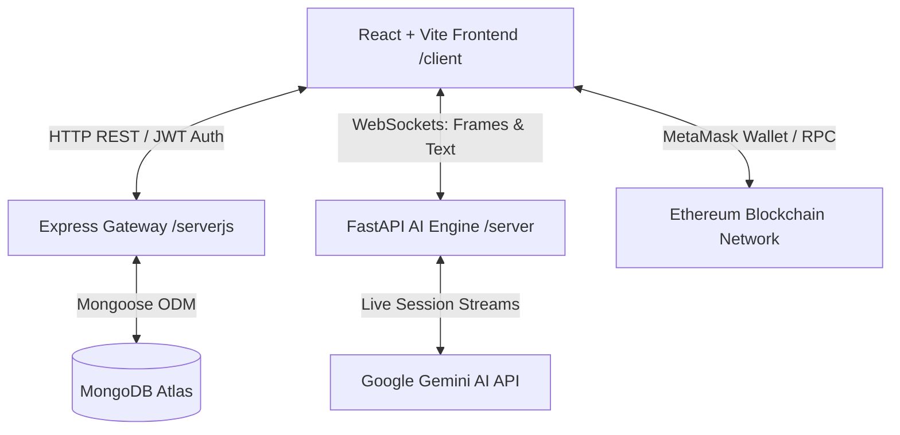

# 🧠 MindEase: AI-Powered Empathetic Mental Health Platform

**MindEase** is a comprehensive, multi-tiered mental health and therapeutic support platform. It combines real-time computer vision (facial emotion recognition), real-time conversational AI (multimodal Gemini voice and text chat), interactive 3D visualizations, analytical dashboarding, and blockchain-based therapist scheduling to deliver a secure, highly personalized, and empathetic wellness experience.

---

## 🚀 Architecture Overview

The system is split into three main modules:



### 1. Frontend Client ([`client`](file:///c:/Users/SUVIR%20ARORA/OneDrive/Documents/go-comet/mental-health/client))
A React-based single-page application built on top of **Vite** and **TailwindCSS 4**.
- **Interactive Visuals**: Implements 3D components utilizing `@react-three/fiber` and `@react-three/drei` (Three.js) alongside smooth animations powered by `framer-motion`.
- **Media Streams**: Processes real-time audio and video capture for speech and facial expression tracking.
- **Web3 Booking**: Connects directly to the Ethereum blockchain network via MetaMask and `ethers.js` to manage session bookings.

### 2. User Management & Data Gateway ([`serverjs`](file:///c:/Users/SUVIR%20ARORA/OneDrive/Documents/go-comet/mental-health/serverjs))
A REST API gateway running on **Node.js** and **Express**.
- **Database**: Uses **MongoDB** and **Mongoose** to persist user details, configuration schemas, and chat sessions.
- **Security**:
  - Employs **AES-256-GCM** symmetric encryption for storing chat content (using unique initialization vectors `iv` and authentication tags `authTag`).
  - Implements **JSON Web Tokens (JWT)** for session authentication.
  - Integrates **Passport.js** for Google OAuth2.0 authentication.
- **Media Hosting**: Integrates **Multer** and **Cloudinary** for secure profile image uploads.

### 3. AI & Real-Time Engine ([`server`](file:///c:/Users/SUVIR%20ARORA/OneDrive/Documents/go-comet/mental-health/server))
A Python **FastAPI** backend that acts as the real-time AI processing pipeline.
- **Facial Emotion Recognition**: Deploys **DeepFace** (utilizing OpenCV) to detect emotions (happy, sad, angry, anxious, neutral, etc.) frame-by-frame from client camera feeds.
- **Multimodal AI**: Communicates with the Google GenAI SDK (Gemini Live API) over WebSockets to support real-time text and low-latency voice-to-voice streaming.
- **Distress Evaluation**: Evaluates emotional trajectories using a dedicated Gemini endpoint to calculate a distress score ranging from `0` to `10`.

---

## ✨ Key Features

| Feature | Description | Tech Stack |
| :--- | :--- | :--- |
| **Empathetic Chat** | A smart chat system where Gemini is fed with the user's latest mood, triggers, coping mechanisms, and conversation history, delivering highly responsive guidance. | Gemini 1.5/3.1, WebSockets |
| **Facial Emotion Tracking** | Continuous expression analysis during sessions, feeding context (e.g., *"My current emotion is sad"*) back into the AI counselor to customize tone. | DeepFace, OpenCV, WebSockets |
| **Real-time Voice Therapy** | Low-latency audio-in/audio-out sessions to speak directly with the therapist avatar. | Gemini Multimodal Live, Howler.js |
| **Distress Dashboard** | Evaluates a distress rating (`0` to `10`) over the conversation history and plots it on interactive charts to visualize recovery trends. | Recharts, FastAPI, Mongoose |
| **Web3 Booking System** | A smart-contract-based booking calendar. Users pay in Ether to book appointments with real-world therapists; payments are securely locked and released. | Ganache, Solidity, Ethers.js, MetaMask |
| **Community Forum & Resources**| Peer-to-peer discussion threads, helplines, relaxation guides, and audio meditation scripts. | React, MongoDB |

---

## 💾 Database Schemas

### User Profile (`UserProfile.js`)
Stores health configurations and personalized triggers which are dynamically injected into the AI's prompts:
- **Demographics**: `name`, `age`, `gender`, `preferredLanguage`.
- **Behavioral Data**: `stressFrequency`, `diagnosedCondition`, `sleepHours`, `exerciseFrequency`, `hasSupportSystem`.
- **Triggers & Coping**: Arrays of user-identified triggers and coping strategies.
- **Preferences**: `responsePreference` (e.g., clinical, casual, structured), `wantsAffirmations`, `wantsReminders`.

### Encrypted Chat Sessions (`Chat.js`)
To protect user privacy, message content is encrypted end-to-end:
- **Encrypted text**: AES-256 cipher string.
- **Encryption Metadata**: Hex-encoded `iv` (Initialization Vector) and `authTag`.
- **Context Metadata**: Captured `emotion` tag and calculated `distressScore` (0-10) for each message turn.

---

## 🛠️ Installation & Setup

### Prerequisites
- **Node.js** (v18.x or above)
- **Python 3.10+** (with virtual environment support)
- **MongoDB** (local installation or MongoDB Atlas instance)
- **MetaMask browser extension** & **Ganache** (local Ethereum block explorer running on port `7545`)
- Google GenAI API Key

---

### Step 1: Clone the Repository
```bash
git clone <repository-url>
cd mental-health
```

### Step 2: Database & Auth Server (`serverjs`)
1. Navigate to the Node server directory:
   ```bash
   cd serverjs
   ```
2. Install Node dependencies:
   ```bash
   npm install
   ```
3. Create a `.env` file in `serverjs/` and add the following keys:
   ```env
   PORT=4000
   MONGODB_URI=mongodb+srv://<username>:<password>@cluster.mongodb.net/mindease
   JWT_SECRET=your_jwt_secret_phrase
   MESSAGE_ENCRYPTION_KEY=your_aes_encryption_key_32_bytes_hex
   GOOGLE_CLIENT_ID=your_google_oauth_client_id
   GOOGLE_CLIENT_SECRET=your_google_oauth_client_secret
   SESSION_SECRET=your_express_session_secret
   CLOUDINARY_CLOUD_NAME=your_cloudinary_cloud_name
   CLOUDINARY_API_KEY=your_cloudinary_api_key
   CLOUDINARY_API_SECRET=your_cloudinary_api_secret
   ```
4. Spin up the Express server:
   ```bash
   npm start
   ```

---

### Step 3: AI & Media Processing Engine (`server`)
1. Navigate to the Python server directory:
   ```bash
   cd ../server
   ```
2. Create and activate a Python virtual environment:
   ```bash
   python -m venv venv
   # On Windows:
   .\venv\Scripts\activate
   # On macOS/Linux:
   source venv/bin/activate
   ```
3. Install the required Python libraries:
   ```bash
   pip install -r requirements.txt
   ```
4. Create a `.env` file in `server/` with the following:
   ```env
   GEMINI_API_KEY=your_google_gemini_api_key
   GEMINI_MODEL=gemini-3.1-flash-live-preview
   GEMINI_TEXT_MODEL=gemini-3.1-flash-live-preview
   GEMINI_AUDIO_MODEL=gemini-2.5-flash-native-audio-preview-12-2025
   ```
5. Run the FastAPI development server:
   ```bash
   uvicorn main:app --host 127.0.0.1 --port 8000 --reload
   ```

---

### Step 4: Frontend Client (`client`)
1. Navigate to the client directory:
   ```bash
   cd ../client
   ```
2. Install client dependencies:
   ```bash
   npm install
   ```
3. Ensure **Ganache** is running locally on port `7545` and MetaMask is connected to it. Connect MetaMask to Ganache and import one of Ganache's pre-funded accounts.
4. Launch the front-end application:
   ```bash
   npm run dev
   ```
5. Open your browser to the local port listed (usually `http://localhost:5173`).

---

## 🔒 Security, Safety, & Disclaimer
1. **Disclaimer**: **MindEase is an AI therapeutic simulation.** It does not replace professional therapy, clinical psychiatry, or emergency response systems. If you are experiencing a crisis, please seek immediate help from professional services.
2. **Data Privacy**: Chat logs are encrypted using **AES-256-GCM** before being written to the database. Decryption is performed in-memory at the Express server level only for authorized sessions.
3. **Trigger Detection**: The application automatically tracks the calculated distress score. When it detects elevated distress indicators (scores `7+`), it prompts the user with resources and references to clinical helplines.
